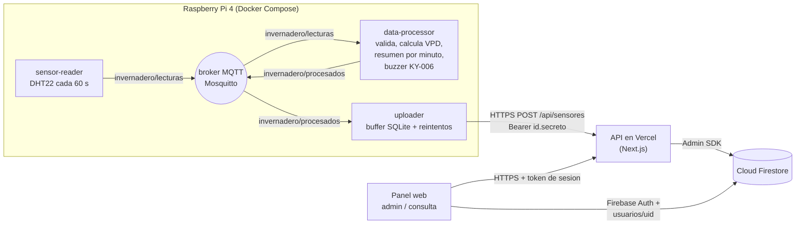

# Invernadero IoT

Solemne 1 - Infraestructura TI (UNAB). Sistema de monitoreo de invernaderos y huertos: una Raspberry Pi 4 mide temperatura y humedad con un sensor DHT22, resume los datos cada minuto, dispara una alarma sonora (buzzer) cuando algo sale de rango y los envía a una plataforma web que los muestra en un panel.

- **Plataforma web:** https://invernadero-iot-monitoreo.vercel.app
- **Repositorio:** https://github.com/sebastianihg05/invernadero-iot-monitoreo

## Arquitectura



Flujo de un dato: el `sensor-reader` lee el DHT22 y publica la lectura por MQTT. El `data-processor` la valida, calcula el VPD, acumula un resumen por minuto (promedio, mínimo y máximo) y hace sonar el buzzer si hay una alerta. El `uploader` toma el resumen y lo envía a la API; si no hay internet lo guarda en SQLite y lo reintenta, sin perder ni duplicar datos. La API lo guarda en Firestore y el panel lo consulta.

## Estructura del repositorio

| Carpeta | Contenido |
|---|---|
| `device/` | Microservicios que corren en la Raspberry Pi (`sensor-reader`, `data-processor`, `uploader`, `mqtt-broker`) y su `docker-compose.yml` |
| `web/` | Plataforma web y API (Next.js, se despliega en Vercel) |
| `firebase/` | Reglas (`firestore.rules`) e índices (`firestore.indexes.json`) de Firestore |

## Instalación desde cero

### 1. Firebase

1. Crear un proyecto en [Firebase Console](https://console.firebase.google.com) y activar **Authentication** (método correo y contraseña) y **Cloud Firestore**.
2. Publicar las reglas: en Firestore > Reglas, pegar el contenido de `firebase/firestore.rules` y publicar. Alternativa con la CLI: `cd firebase && firebase deploy --only firestore`.
3. Generar la clave de la cuenta de servicio: Configuración del proyecto > Cuentas de servicio > *Generar nueva clave privada*. Se usa en el paso siguiente.
4. Crear el primer administrador: registrarse desde la web y, en Firestore, editar su documento en `usuarios/{uid}` cambiando `rol` de `estudiante` a `admin`. Los administradores solo se asignan a mano desde la consola, nunca desde la web.

### 2. Plataforma web (Vercel)

1. Importar el repositorio en [Vercel](https://vercel.com) con **Root Directory** = `web`.
2. Cargar las variables de entorno (ver `web/.env.example`).
3. Desplegar. Cada push a `main` redespliega solo.

Para correr en local:

```bash
cd web
cp .env.example .env.local   # completar con la clave de la cuenta de servicio
npm install
npm run dev                  # http://localhost:3000
```

### 3. Raspberry Pi

Requisitos: Raspberry Pi 4 con Docker y el plugin Compose, un sensor DHT22 en el GPIO 4 y un buzzer KY-006 en el GPIO 17.

1. Entrar al panel como admin y registrar el dispositivo (vista de dispositivos, o `POST /api/dispositivos`). Se muestra un token con forma `id.secreto` **una sola vez**: copiarlo.
2. En la Raspberry:

```bash
git clone https://github.com/sebastianihg05/invernadero-iot-monitoreo.git
cd invernadero-iot-monitoreo/device
cp .env.example .env
nano .env                    # API_URL y DEVICE_TOKEN (el token del paso 1)
docker compose up -d --build
docker compose logs -f       # ver que los 4 contenedores arrancan
```

Para probar sin sensor conectado, poner `MODO_SIMULADO=true` en el servicio `sensor-reader` del `docker-compose.yml`.

## Variables de entorno

**Web (`web/.env.example`)**

| Variable | Obligatoria | Descripción |
|---|---|---|
| `FIREBASE_PROJECT_ID` | Sí | ID del proyecto de Firebase |
| `FIREBASE_CLIENT_EMAIL` | Sí | Correo de la cuenta de servicio |
| `FIREBASE_PRIVATE_KEY` | Sí | Clave privada de la cuenta de servicio (con los saltos de línea como `\n`) |
| `DEVICE_ID` | No | Dispositivo que muestra el panel. Por defecto `invernadero-01` |
| `FIRESTORE_MAX_DOCS_POR_DIA` | No | Tope diario de documentos leídos por el panel. Por defecto `25000` |

**Raspberry (`device/.env.example`)**

| Variable | Descripción |
|---|---|
| `API_URL` | URL de la API, termina en `/api/sensores` |
| `DEVICE_TOKEN` | Token del dispositivo (`id.secreto`) |

Los umbrales de alerta se pueden ajustar con las variables `TEMP_MIN`, `TEMP_MAX`, `HUM_MIN` y `HUM_MAX` del servicio `data-processor` (por defecto 18-30 °C y 40-80 %).

## API

Base: `https://invernadero-iot-monitoreo.vercel.app`. Los endpoints del panel exigen el token de sesión de Firebase en la cabecera `Authorization: Bearer <idToken>`; la Raspberry usa su token de dispositivo.

| Método y ruta | Quién | Descripción |
|---|---|---|
| `GET /api/sensores?range=1h\|24h\|7d` | Admin o estudiante | Resúmenes por minuto, conteos y últimas alertas del período |
| `POST /api/sensores` | Dispositivo | Recibe un resumen por minuto de la Raspberry |
| `GET /api/admin/historial?days=8..30` | Admin | Historial extendido (8 a 30 días) en formato compacto |
| `GET /api/dispositivos` | Admin | Lista los dispositivos (sin el hash del token) |
| `POST /api/dispositivos` | Admin | Registra un dispositivo y devuelve su token una sola vez |
| `PATCH /api/dispositivos/{id}` | Admin | `{ "accion": "revocar" \| "reactivar" }` |

Ejemplos:

```bash
# Leer las mediciones de la última hora (usuario con sesión)
curl -H "Authorization: Bearer $ID_TOKEN" \
  "https://invernadero-iot-monitoreo.vercel.app/api/sensores?range=1h"

# Registrar un dispositivo (admin). Devuelve { "id": "...", "token": "id.secreto" }
curl -X POST -H "Authorization: Bearer $ID_TOKEN" -H "Content-Type: application/json" \
  -d '{"id":"invernadero-01","nombre":"Invernadero principal"}' \
  https://invernadero-iot-monitoreo.vercel.app/api/dispositivos

# Revocar un dispositivo (admin)
curl -X PATCH -H "Authorization: Bearer $ID_TOKEN" -H "Content-Type: application/json" \
  -d '{"accion":"revocar"}' \
  https://invernadero-iot-monitoreo.vercel.app/api/dispositivos/invernadero-01

# Enviar un resumen (lo hace el uploader de la Raspberry)
curl -X POST -H "Authorization: Bearer $DEVICE_TOKEN" -H "Content-Type: application/json" \
  -d '{"id_resumen":"3f2c...","tipo":"resumen_minuto","device_id":"invernadero-01",
       "timestamp":"2026-10-27T19:00:00Z","estado":"normal",
       "temperatura_c":{"promedio":24.1,"minima":23.8,"maxima":24.5},
       "humedad_pct":{"promedio":61.2,"minima":60.9,"maxima":61.7},
       "vpd_kpa":{"promedio":1.15,"minima":1.12,"maxima":1.18},
       "buzzer_activo":false,"eventos":[]}' \
  https://invernadero-iot-monitoreo.vercel.app/api/sensores
```

Errores comunes: `401` sin sesión o token inválido, `403` sin permisos, `429` si se alcanzó el tope diario de lecturas del panel.

## Modelo de datos (Firestore)

```
usuarios/{uid}
    nombre, correo, rol ("admin" | "estudiante"), fechaRegistro

dispositivos/{deviceId}
    nombre, tokenHash, activo, lastSeenAt, creado
    resumenes/{idResumen}                  (un documento por minuto)
        tipo, device_id, timestamp (ISO 8601), periodo_segundos, estado
        conteos: { total, normales, alertas, invalidas, simuladas }
        temperatura_c / humedad_pct / vpd_kpa: { promedio, minima, maxima }
        buzzer_activo (true si sonó en ese minuto)
        eventos: [ { id_lectura, timestamp, sensor, estado, motivos, temperatura_c, humedad_pct } ]
```

El `idResumen` es un UUID generado por la Raspberry: si reenvía un resumen tras un corte, se sobrescribe el mismo documento y no se duplica.

**Índices** (`firebase/firestore.indexes.json`): todas las consultas filtran y ordenan por un solo campo (`timestamp`) dentro de la subcolección `resumenes`, por lo que Firestore las resuelve con sus índices automáticos de un campo y no se necesita ningún índice compuesto. El archivo se mantiene vacío a propósito; si más adelante se agrega una consulta que combine campos, el índice se declara ahí.

## Seguridad

- **Reglas de Firestore** (`firebase/firestore.rules`): el navegador solo accede a `usuarios`. Cada usuario lee su propio documento, el admin lista a todos, y el registro solo permite crear el propio documento con rol `estudiante` y correo institucional (`@unab.cl` o `@uandresbello.edu`). Nadie puede modificar ni borrar usuarios desde el navegador, así que un estudiante no puede subirse a admin. Todo lo demás está cerrado: los dispositivos y resúmenes se manejan solo desde la API.
- **API:** los endpoints del panel verifican el token de sesión de Firebase y leen el rol en el servidor; los de administración exigen rol `admin`.
- **Dispositivos:** cada Raspberry usa su propio token (`id.secreto`), del que Firestore solo guarda el hash. Un token puede revocarse sin afectar a los demás, y solo puede guardar datos a nombre de su propio dispositivo.
- **Secretos:** la clave de la cuenta de servicio y los tokens viven solo en variables de entorno (`.env` y `.env.local` están fuera del repositorio).
- **Raspberry:** los contenedores corren sin modo privilegiado, con acceso únicamente a los GPIO necesarios; el broker MQTT no expone puertos fuera de la red interna de Docker.

## Uso y capacidad

El panel respeta la cuota gratuita de Firestore (50.000 lecturas al día): usa caché en memoria por período y un tope diario de documentos leídos (`FIRESTORE_MAX_DOCS_POR_DIA`). Se guarda un documento por minuto, unos 1.440 al día.

## Limitaciones conocidas

- **Configuración remota:** la pantalla de configuración existe pero es solo visual. Todavía no hay endpoint en la API ni servicio en la Raspberry que aplique cambios de umbrales a distancia; los umbrales se ajustan con variables de entorno del `data-processor`.
- **Organizaciones aisladas:** el sistema es de una sola organización. Los datos de distintos clientes no están separados.
- **Control del buzzer:** el panel muestra si el buzzer sonó, pero los controles para activarlo o silenciarlo desde la web aún no están habilitados.

## Integrantes

- Vanessa Lagos
- Héctor Peña
- Sebastián Hidalgo
- Claudio Ojeda
- Leonardo Burgos
